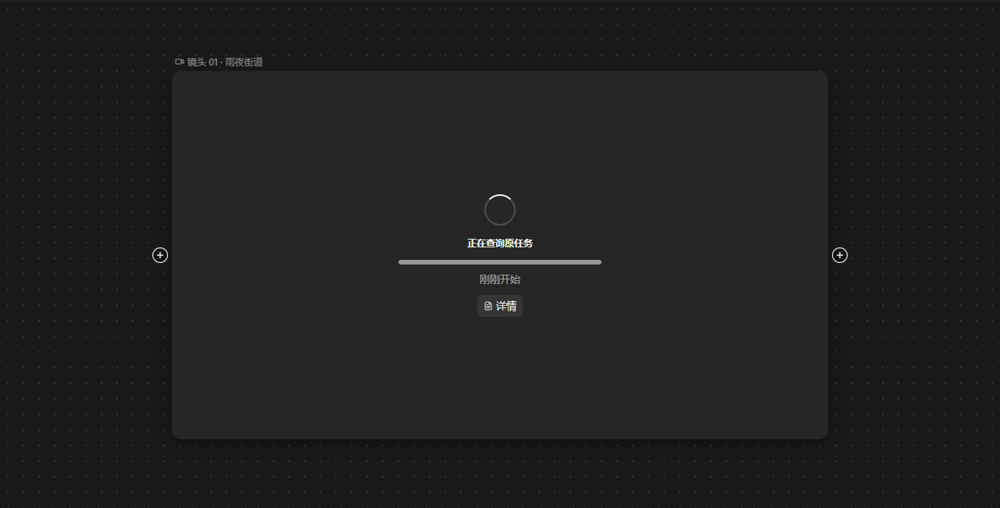
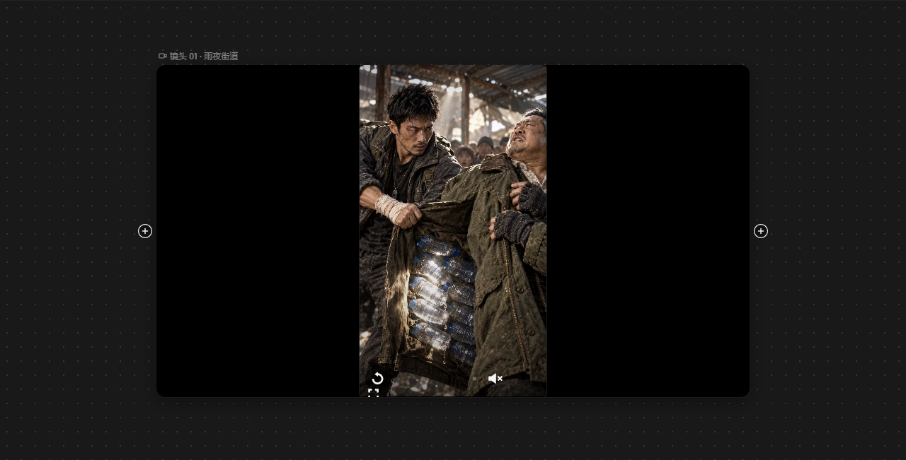
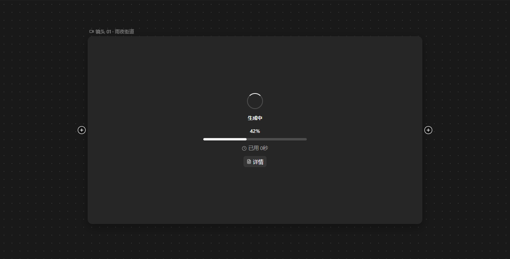
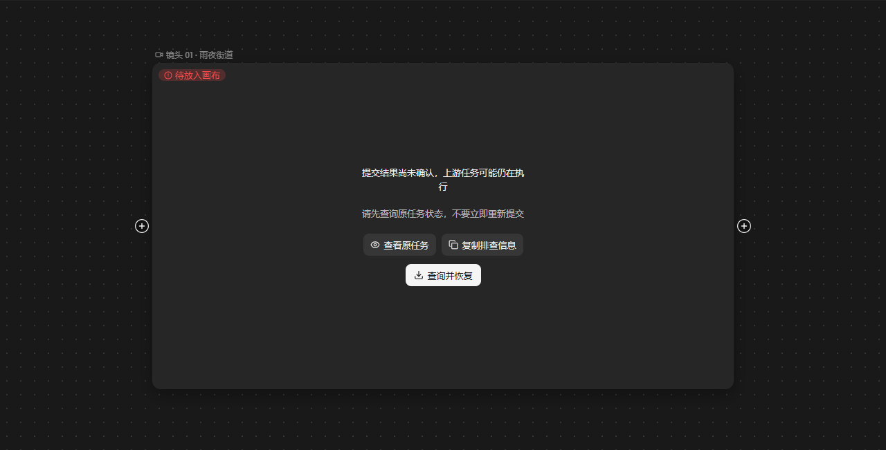
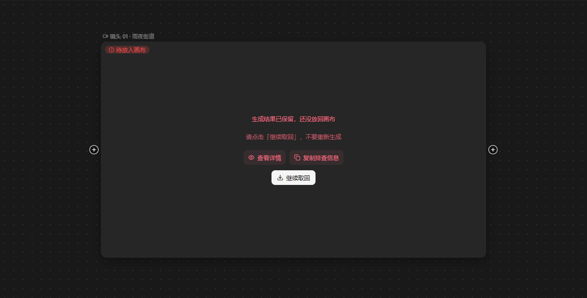

# 画布原节点恢复验收

## 范围

浏览器页复用生产 `CanvasNode`、`useCanvasResourceHandoff`、任务查询模块和 `retryStoredCanvasVideo`，由 Vite 加载生产样式与主题。仅测试外壳、API 回执与结果落入节点的适配器使用确定性测试数据。成功后的播放使用仓库已有演示视频。

这是组件联调与浏览器交互证据，不是完整桌面应用、真实后端持久化或付费模型验收。原任务详情用例只验证入口回调，详情外壳为测试桩。没有连接真实模型、提交付费生成、修改用户工作区数据或发版。

## 结果

- 同步主分支后 42 项专项检查通过，覆盖服务查询、状态映射、恢复 Hook、原视频重试、失败操作与统一 `task.outcome` 合同。
- 10 组真实浏览器用例通过，包含四种归属变化子场景；浏览器为 Windows Edge，通过 Node 驱动 Playwright。
- 补充 3 组暗色画布流转检查通过：查询与生成状态区分、恢复后播放、确认失败后的键盘重试，以及查询/回写失败后的恢复。`dark-*.png` 直接截取画布区域，不含测试外壳标题与说明。
- `bun run build`（含 TypeScript 检查）、`bun run lint` 与 `git diff --check` 通过。构建保留大 chunk 提示，不作为本次改动引入的故障。

| 浏览器用例 | 已核对行为 |
| --- | --- |
| 待确认 → 查询 → 生成中 → 成功 | 原节点 ID、位置和任务 ID 保留；真实视频可解码播放；不调用生成重试 |
| 明确未提交 → 用户点击重新生成 → 成功 | 确认失败前不重试，用户点击后只重试一次，结果仍在原节点 |
| 暗色主题、上游仍待确认 | 键盘可触发查询，保留查询按钮，付费重试入口不出现 |
| 查询失败 | 恢复可操作的待确认状态，不伪报已有结果 |
| 结果回写失败 | 保留「继续取回」，再次取回不重新生成 |
| 重复点击与归属变化 | 合并同节点重复操作；切换画布、切换账号、节点换任务、删除节点后不接收旧响应 |
| 上游已成功 | 查询现有上游任务并应用结果，不重试生成 |
| 上游查询冲突或缺上游 ID | 由免费 `/recover` 判断能否恢复，不把查询失败当作未提交 |
| 取回暂停 | 恢复同任务交付，不创建新生成任务 |
| 原任务详情 | 点击详情入口不触发恢复或生成 |

每个浏览器用例还检查未捕获页面错误及预期外的 API 写请求。

截图检查发现查询期间沿用了「生成中」，已改为「正在查询原任务」，不展示生成百分比，也不提供取消原生成任务的操作。

## 复现

需要仓库锁定的 Bun、Node 24 和可供 Playwright 使用的浏览器。可设置 `CHROME_PATH` 使用本机 Chrome/Edge；未设置时使用 Playwright 安装的 Chromium。

```sh
cd web
bun install --frozen-lockfile
bun test test/canvas-generation-recovery.test.ts test/canvas-node-generation-recovery.test.tsx test/canvas-node-recovery-flow.test.tsx test/canvas-video-retry.test.ts test/canvas-generation-failure.test.ts test/generation-failure-actions.test.tsx test/task-outcome.test.ts
bun test test/canvas-node-recovery.browser.test.ts
bun run build
bun run lint
```

浏览器测试仅在本机临时端口启动验收页面，结束后关闭页面与服务。Windows 下通过 Node 运行 Vite 和 Playwright，避免 Bun 的子进程管道初始化挂起。

## 截图

截图由测试生成到仓库根目录的 `output/canvas-node-recovery/`，该目录由 Git 忽略。以下六张画布截图随评审记录保存，完整截图可运行上述用例生成。

| 待确认 | 查询原任务 | 恢复成功 |
| --- | --- | --- |
|  |  |  |

| 原任务生成中 | 查询失败 | 结果回写失败 |
| --- | --- | --- |
|  |  |  |

| 文件 | 状态 |
| --- | --- |
| `01-uncertain-light.png` | 待确认，提供查询入口 |
| `02-querying-light.png` | 正在查询原任务 |
| `03-running-light.png` | 原任务仍在生成 |
| `04-recovered-light.png` | 成功恢复并加载实际视频画面 |
| `05-confirmed-failure-light.png` | 确认未提交后允许原位重新生成 |
| `06-uncertain-dark.png` | 暗色主题待确认 |
| `07-still-uncertain-dark.png` | 查询后仍待确认 |
| `08-query-failed-light.png` | 查询失败后恢复操作入口 |
| `09-apply-failed-light.png` | 已有结果等待继续取回 |
| `10-original-task-details.png` | 原任务详情入口测试桩 |
| `dark-01-uncertain.png` | 暗色待确认，仅画布区域 |
| `dark-02-querying.png` | 暗色查询原任务 |
| `dark-03-generating.png` | 暗色原任务继续生成 |
| `dark-04-recovered.png` | 暗色恢复成功并加载视频 |
| `dark-05-confirmed-failure.png` | 暗色确认失败，可原位重试 |
| `dark-06-retrying.png` | 暗色用户主动重试后生成中 |
| `dark-07-query-failed.png` | 暗色查询失败，保留查询入口 |
| `dark-08-apply-failed.png` | 暗色结果回写失败，可继续取回 |
